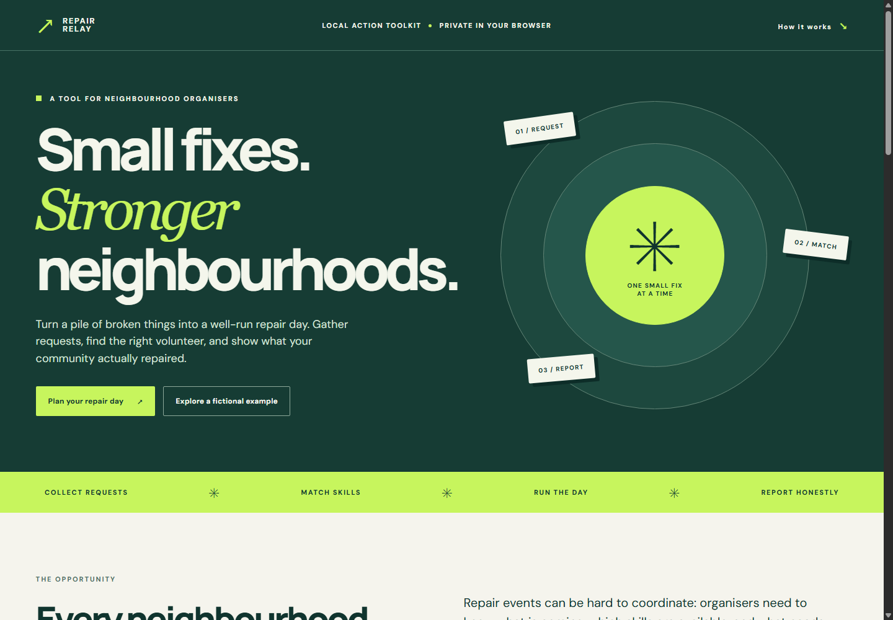

# Repair Relay

The [planning board](assets/planning-board.png) and [safety review](assets/safety-review.png) screenshots show the labelled fictional example. No real repair outcomes are represented.

[Guida rapida in italiano per provare la demo](START_HERE_IT.md).

A free browser-based planner for local repair events, built from scratch on 17 October 2026 during Neighborhood Hacks 2026.

## Problem

Repair-day organisers need to gather requests, know volunteer skills, avoid overbooking, hold risky cases for review, and record real outcomes. ISTAT's Urban Environment 2024 report says repair or preparation-for-reuse centres were present in 19.6% of Italian provincial-capital municipalities in 2024: https://www.istat.it/comunicato-stampa/ambiente-urbano-anno-2024/ . This is national context, not evidence about any specific neighbourhood. No pilot or user interviews are claimed.

## Features

- Event date, place, start time, and duration.
- Repair requests with category, duration, optional weight, priority, and safety flag.
- Volunteer aliases, skills, and available minutes.
- Transparent skill- and capacity-aware matching, with a timed schedule.
- Safety review hold and waitlist that explains missing skills or volunteer capacity.
- Outcome recording with fictional examples excluded from reported totals.
- Browser storage, JSON export/import, and print view. Example loading and import ask before replacing existing work.
- Optional Node HTTP scheduling endpoint.

## Run and test

Requires Node.js 20 or newer. No package install, API key, account, or paid service.

    npm start
    npm test
    npm run build

Optional: `npm run screenshots` regenerates two submission screenshots from the fictional example. It requires Playwright and a local Chrome installation; the app itself does not. The same optional tools run `npm run browser-smoke` to check browser interactions.

Visit http://127.0.0.1:3000 after starting. The build command copies the static browser app into this project's docs folder. POST /api/schedule accepts an exported board JSON and returns the plan. The browser uses the same engine locally, so static hosting needs no server.

## Architecture

- public/core.js: validation, matching, summary.
- public/app.js: local state, forms, DOM rendering, import/export.
- public/index.html and public/styles.css: responsive interface.
- server.js: optional Node static host and scheduling API.
- test/core.test.js: matching, safety, data validation, HTTP tests.
- scripts/build.mjs: static build.

Pending requests are sorted by priority, estimated duration, then ID. Each goes to a compatible volunteer with enough capacity; the volunteer with the lowest booked-to-available ratio wins. Assignments are sequential per volunteer. Safety-flagged requests are never matched automatically. This is a deterministic heuristic, not machine learning or a claim of globally optimal scheduling.

## Safety, privacy, and evidence

This app is not a repair manual. A qualified person must review flagged items before work begins. Browser data is stored in localStorage; the server stores nothing. Review exported JSON before sharing, use nicknames, and avoid contact or medical details. Repaired counts and item weights are self-reported and not independently verified. Weight is not equivalent to waste avoided.

The fictional example is labelled and excluded from reported repaired totals. The project was built with OpenAI Codex assistance for code, tests, design, and writing during the event window. The entrant must understand and review the work. There is no paid AI API or hidden generative feature. Earlier work in the parent repository is separate and was not reused.

## Competition notes and limits

The Neighborhood Hacks rules and FAQ say the event is online, free, open to high-school students worldwide ages 13–21, permits solo teams, and permits AI assistants with disclosure:
https://neighborhood-hacks-2026.devpost.com/rules
https://neighborhoodhacks.org/faq/

The kickoff update published the prompt: build a working solution to a problem the entrant has personally seen affect people nearby (https://neighborhood-hacks-2026.devpost.com/updates/47044-neighborhood-hacks-starts-now). The dedicated challenge page still says "TO BE ANNOUNCED", but the update supplies the operative prompt. Project fit remains conditional on the entrant providing a truthful local observation. The submission requires a 2–6 minute working demo video, public source, and written problem evidence. See SUBMISSION.md and DEMO_SCRIPT.md.

The heuristic does not model breaks, stations, or safety qualifications. A real event should validate demand with its community and gain consent for personal data.

Public demo: https://masomo88.github.io/RepairRelay-NeighborhoodHacks-2026/

Public source: https://github.com/masomo88/RepairRelay-NeighborhoodHacks-2026

Captioned 2:21 demo video: https://masomo88.github.io/RepairRelay-NeighborhoodHacks-2026/video.html
Unlisted YouTube demo for the Devpost video field: https://youtu.be/kOVYe9LRZQk . The Pages-hosted WebM is a review copy.
